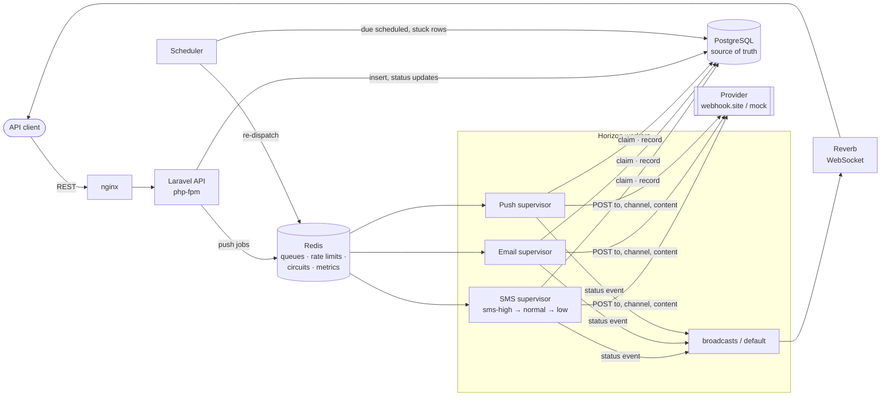
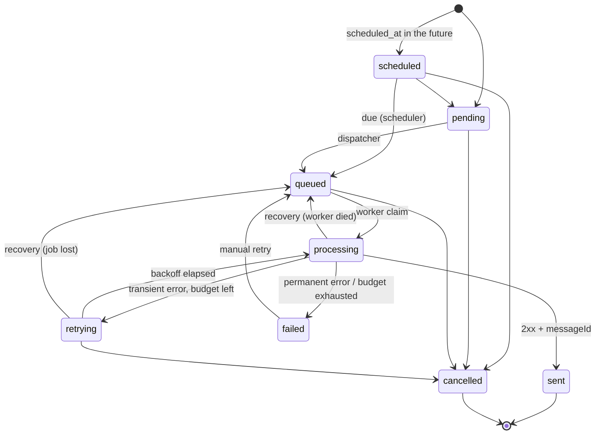

# Insider Notification System

[](https://github.com/msalimcengiz/insider-notification-system/actions/workflows/ci.yml)

An event-driven notification service that accepts **SMS**, **email** and **push** notifications over a REST API and delivers them asynchronously. It handles bursts, retries failed deliveries intelligently, and shows delivery status in real time.

**Stack:** PHP 8.4, Laravel 13, PostgreSQL 16, Redis 7, Laravel Horizon, Laravel Reverb, Docker Compose.

```bash
docker compose up
```

That one command builds the image, installs dependencies, creates `.env`, runs migrations and starts every service.

---

## Contents

- [Requirements coverage](#requirements-coverage)
- [Quick start](#quick-start)
- [API tour](#api-tour)
- [Architecture](#architecture)
- [Design decisions](#design-decisions)
- [Configuration](#configuration)
- [Testing](#testing)
- [Load test](#load-test)
- [Project structure](#project-structure)
- [Trade-offs and next steps](#trade-offs-and-next-steps)

---

## Requirements coverage

| Requirement | Implementation |
|---|---|
| Create with recipient, channel, content, priority | `POST /api/v1/notifications`, with per-channel validation (E.164, email, device token) |
| Batch creation (≤ 1000) | `POST /api/v1/notifications/batch`: chunked bulk insert, one dispatch round trip per chunk |
| Query by ID / batch ID | `GET /api/v1/notifications/{id}` (with attempt history), `GET /api/v1/batches/{id}` (per-status counts, progress) |
| Cancel pending | `POST /api/v1/notifications/{id}/cancel`, `POST /api/v1/batches/{id}/cancel`, both atomic against workers |
| List with filters and pagination | `GET /api/v1/notifications?status=&channel=&priority=&from=&to=&batch_id=&recipient=`, cursor paginated |
| Async processing via queue workers | Redis queues and Horizon, one supervisor per channel |
| 100 msg/s per channel | Strict sliding-window limiter in Redis (Lua), shared by every worker |
| Priority queues | One queue per channel × priority, drained strictly high → normal → low |
| Content validation | Per-channel limits: SMS by **segments** (GSM-7 / UCS-2), push and email by length, required fields |
| Idempotency | `Idempotency-Key` header, per-item keys in batches, atomic worker claims, provider `Idempotency-Key` |
| Delivery & retry logic | Error classification, exponential backoff with jitter, `Retry-After`, circuit breaker, recovery sweeper, manual retry |
| Metrics endpoint | `GET /api/v1/metrics`: queue depth, success / failure rates, latency p50/p95/p99, throughput, circuit state |
| Structured logs with correlation IDs | JSON logs; `X-Correlation-ID` follows a notification from the API to the worker and the provider call |
| Health check | `GET /api/v1/health`: PostgreSQL, Redis, Horizon, circuits (`ok` / `degraded` / `down`) |
| webhook.site provider | Exact request format, `202` + `messageId`, configurable URL (a mock provider is bundled) |
| **Bonus:** failure handling | Circuit breaker, recovery sweeper, failed list (`?status=failed`), manual retry with a fresh budget |
| **Bonus:** scheduled notifications | `scheduled_at` (≤ 30 days ahead), dispatched every 10 s, cancellable until then |
| **Bonus:** templates | `/api/v1/templates` CRUD and preview, `{{ variable }}` substitution |
| **Bonus:** WebSocket updates | Laravel Reverb: `notifications.{id}` / `batches.{id}` channels, demo page |
| **Bonus:** CI/CD | GitHub Actions: Pint, Larastan level 8, tests, OpenAPI drift check, image published to GHCR |
| **Bonus:** distributed tracing | Not implemented; correlation IDs cover request → worker → provider. See [next steps](#trade-offs-and-next-steps) |
| Deliverables | Docker Compose, OpenAPI spec ([`openapi.json`](openapi.json) and `/docs/api`), versioned migrations, single-command test suite |

---

## Quick start

Requirements: Docker with Docker Compose. Nothing else is needed on the host.

The source is bind-mounted into the containers. On macOS, clone into a folder Docker Desktop shares (anything under `/Users` is shared by default; `/tmp` is not).

```bash
git clone https://github.com/msalimcengiz/insider-notification-system.git
cd insider-notification-system
docker compose up        # first boot takes a minute: composer install + migrations
```

| Service | URL |
|---|---|
| REST API | http://localhost:8000/api/v1 |
| API docs (Swagger UI) | http://localhost:8000/docs/api |
| Horizon (queues dashboard) | http://localhost:8000/horizon |
| WebSocket demo | http://localhost:8000/ws-demo.html |
| WebSocket server (Reverb) | ws://localhost:8080 |
| Mock provider stats | http://localhost:8081/stats |

Seed a few ready-to-use templates:

```bash
docker compose exec app php artisan db:seed
```

### Using webhook.site instead of the mock provider

By default deliveries go to the bundled mock provider, so the stack works offline and under load. To use [webhook.site](https://webhook.site):

1. Create a URL there. Under *Edit*, set the default response to status **202**, content type `application/json`, and a body such as:
   ```json
   { "messageId": "6f1c2c1e-3d1a-4f7b-9a59-0c8f0e2b5a11", "status": "accepted", "timestamp": "2026-11-14T12:00:00Z" }
   ```
   Any non-empty `messageId` counts as accepted. webhook.site returns the same body for every request.
2. Put it in `.env`: `NOTIFICATION_PROVIDER_URL=https://webhook.site/<your-uuid>`. You can also set it per channel with `NOTIFICATION_PROVIDER_SMS_URL`, `..._EMAIL_URL` and `..._PUSH_URL`.
3. Restart the workers: `docker compose restart horizon`.

webhook.site's free tier limits the number of requests, so use the mock provider for load tests.

---

## API tour

Every response carries an `X-Correlation-ID` header. Send your own to trace a request end to end.

### Create a notification

```bash
curl -s localhost:8000/api/v1/notifications \
  -H 'Content-Type: application/json' -H 'Accept: application/json' \
  -H 'Idempotency-Key: order-42-shipped' \
  -d '{"channel":"sms","recipient":"+905551234567","content":"Your order has shipped.","priority":"high"}'
```

```json
{
  "data": {
    "id": "01a1da6f-bfb3-72cd-839d-47dbb5f84cc7",
    "channel": "sms", "priority": "high", "status": "queued",
    "recipient": "+905551234567", "content": "Your order has shipped.",
    "attempts": 0, "correlation_id": "01a1da6f-bf74-7064-9305-800d621feacd",
    "created_at": "2026-11-14T14:21:59Z", "...": "..."
  }
}
```

- `202 Accepted`: a new notification was created.
- `200 OK` with `Idempotent-Replayed: true`: the same key was sent again.
- `409`: the key was reused with a different payload.

More request shapes:

```jsonc
// From a template
{ "channel": "email", "recipient": "ada@example.com", "template": "order-shipped-email",
  "variables": { "name": "Ada", "order_id": "42", "eta": "Friday" } }

// Scheduled
{ "channel": "push", "recipient": "<device token>", "content": "Sale starts now!",
  "scheduled_at": "2026-12-01T09:00:00Z" }
```

### Create a batch (up to 1000)

```bash
curl -s localhost:8000/api/v1/notifications/batch \
  -H 'Content-Type: application/json' -H 'Accept: application/json' \
  -d '{"notifications":[
        {"channel":"sms","recipient":"+905551234567","content":"Flash sale!","idempotency_key":"sale-7-user-1"},
        {"channel":"email","recipient":"ada@example.com","content":"Flash sale!","priority":"low"}
      ]}'
```

```json
{ "data": { "batch_id": "01a1da6f-c087-...", "accepted": 2, "duplicates": 0,
  "notifications": [ { "index": 0, "id": "01a1...", "duplicate": false }, { "index": 1, "id": "01a1...", "duplicate": false } ] } }
```

- The whole batch is validated first. If any item is invalid, nothing is created and the errors point at the item: `notifications.3.recipient`.
- Items whose `idempotency_key` already exists are not created again. They come back as `duplicate: true` with the existing ID, so a partially processed batch can be resent safely.

### Track, list, cancel, retry

```bash
curl -s localhost:8000/api/v1/notifications/{id}             # status + delivery attempts
curl -s localhost:8000/api/v1/batches/{batch_id}             # per-status counts, progress %
curl -s 'localhost:8000/api/v1/notifications?status=failed,retrying&channel=sms&from=2026-11-01T00:00:00Z&per_page=50'
curl -s -X POST localhost:8000/api/v1/notifications/{id}/cancel   # 409 if it already reached a worker
curl -s -X POST localhost:8000/api/v1/notifications/{id}/retry    # failed only; fresh retry budget
curl -s -X POST localhost:8000/api/v1/batches/{batch_id}/cancel
curl -s -X POST localhost:8000/api/v1/batches/{batch_id}/retry
```

### Templates

```bash
curl -s localhost:8000/api/v1/templates -H 'Content-Type: application/json' \
  -d '{"name":"otp-sms","channel":"sms","body":"Your code is {{ code }}. It expires in {{ minutes }} minutes."}'
curl -s -X POST localhost:8000/api/v1/templates/{id}/preview -H 'Content-Type: application/json' \
  -d '{"variables":{"code":"482913","minutes":5}}'
```

### Observability

```bash
curl -s 'localhost:8000/api/v1/metrics?window=5' | jq    # sliding window in minutes (1-60)
curl -s localhost:8000/api/v1/health | jq
```

<details>
<summary>Example <code>/metrics</code> response (one channel)</summary>

```json
{
  "window_minutes": 5,
  "overall": { "sent": 564, "failed": 4, "success_rate": 0.993, "attempt_failure_rate": 0.06, "throughput_per_second": 1.88 },
  "channels": {
    "sms": {
      "sent": 186, "failed": 1, "retries_scheduled": 12, "success_rate": 0.9947,
      "attempts": { "total": 200, "success": 186, "retryable_failure": 13, "permanent_failure": 1, "failure_rate": 0.07 },
      "throughput_per_second": 0.62,
      "latency_ms": {
        "provider":   { "avg": 53.4, "p50": 56.3, "p95": 96.4, "p99": 100 },
        "end_to_end": { "avg": 4210, "p50": 2900, "p95": 9273, "p99": 9800 }
      },
      "queues": {
        "high":   { "pending": 0, "delayed": 3, "reserved": 0, "oldest_pending_age_seconds": null },
        "normal": { "pending": 0, "delayed": 9, "reserved": 0, "oldest_pending_age_seconds": null },
        "low":    { "pending": 0, "delayed": 0, "reserved": 0, "oldest_pending_age_seconds": null }
      },
      "circuit": "closed"
    }
  },
  "notifications_in_flight": { "scheduled": 0, "pending": 0, "queued": 0, "processing": 0, "retrying": 12 }
}
```
</details>

### Real-time updates (WebSocket)

Open http://localhost:8000/ws-demo.html, paste a notification or batch ID, and watch the `notification.status` events arrive. Any Pusher-protocol client works:

```js
const pusher = new Pusher('local-notifications-key', { wsHost: 'localhost', wsPort: 8080, forceTLS: false, enabledTransports: ['ws'], cluster: '' });
pusher.subscribe(`batches.${batchId}`).bind('notification.status', (e) => console.log(e.id, e.status));
```

### Testing failure paths by hand

The mock provider fails on purpose when the content contains a marker:

| Marker | Provider answers | System behaviour |
|---|---|---|
| `[mock:503]` / `[mock:500]` | 5xx | retried with backoff, then `failed` |
| `[mock:429]` | 429 + `Retry-After: 5` | retried no sooner than 5 s |
| `[mock:400]` | 400 | `failed` at once (permanent) |
| `[mock:timeout]` | no answer for 30 s | times out after 5 s, retried |

To simulate an outage of every channel, run `MOCK_FAILURE_RATE=1 docker compose up -d mock-provider`. Watch the circuits open in `/metrics` and `/health`. To restore it, run `docker compose up -d mock-provider`.

---

## Architecture



### Life of a notification

1. **Accept.** The API validates the request, renders the template if one is used, and writes the row as `pending`, or `scheduled` if it has a future `scheduled_at`. Batches are written with chunked bulk inserts.
2. **Dispatch.** `UPDATE … SET status='queued' … RETURNING id` moves the rows. Only the rows that call actually moved get a job. Jobs are bulk-pushed to `notifications-{channel}-{priority}`.
3. **Deliver.** A worker of that channel takes the job and runs it through two middleware steps:
   1. The **circuit breaker** check. If the channel's circuit is open, the job is released until the cool-down ends.
   2. The **rate limiter**. If the window is full, the worker waits for the next free slot.

   Then the worker **claims** the row atomically (`queued|retrying → processing`), calls the provider, and records the attempt and the new status in one transaction.
4. **Outcome.**
   - `sent`: a 2xx response with a `messageId`.
   - `retrying`: a transient error with retry budget left. The job is released with a backoff delay.
   - `failed`: a permanent error, or the retry budget is exhausted.

   Every outcome feeds the metrics and the circuit breaker and is broadcast over WebSocket.
5. **Safety nets.** Every 10 s the scheduler queues scheduled notifications that are due. Every minute the recovery sweeper re-dispatches rows stuck in a non-final status.



The allowed transitions live in [`NotificationStatus`](app/Enums/NotificationStatus.php). Every transition in the code is a conditional `UPDATE … WHERE status IN (…)`, so two actors (an API cancel and a worker claim, two workers, two dispatchers) can never both win.

---

## Design decisions

### 1. PostgreSQL is the source of truth, Redis is the transport

Every notification is persisted before it is queued, and every state change is written to PostgreSQL. Redis only carries jobs. Three things can lose a notification "in transit":
- the process dies between marking a row `queued` and pushing its job
- a worker dies mid-delivery
- Redis loses data

The **recovery sweeper** ([`RecoverStuckNotifications`](app/Console/Commands/RecoverStuckNotifications.php)) finds such rows by status and age and dispatches them again. Re-queuing a row that is in fact still queued only creates a duplicate job, and duplicates are harmless because a job must *claim* its row before doing anything. Redis also runs with AOF persistence (`appendfsync everysec`), so a restart normally loses nothing in the first place.

### 2. One queue per channel × priority, strict priority within a channel

There are nine queues: `notifications-{sms,email,push}-{high,normal,low}`. Each channel gets its own fixed-size Horizon supervisor with `balance: false`, which drains its queues strictly in order (high → normal → low).

- **Channel isolation:** a flash sale that floods the SMS queues does not slow email or push, and an SMS backlog that is throttled at 100/s never occupies the email workers.
- **Real priority:** inside a channel, a high-priority message never waits behind low-priority ones.
- **Trade-off:** low priority can starve while high-priority traffic exceeds the channel's rate limit. That is the intended meaning of priority here. A weighted scheme would be a configuration change (separate supervisors per priority).

### 3. A strict sliding-window rate limiter that waits instead of releasing

Laravel's built-in Redis limiter uses a fixed window. Around a window boundary it lets up to **2×** the limit through: 100 at 0.99 s and 100 more at 1.01 s. [`SlidingWindowRateLimiter`](app/Services/RateLimiting/SlidingWindowRateLimiter.php) works differently:
- It keeps the timestamp of every accepted call in a sorted set.
- It checks and adds in **one Lua script**, which is atomic across all workers.
- It uses **Redis' own clock**, so clock skew between worker containers does not matter.

The result is that no 1000 ms window ever contains more than 100 calls per channel. This was verified on Redis' clock with 16 processes competing for slots: 400 calls allowed in 3 s, and at most 100 in any 1000 ms.

The [`ThrottleChannel`](app/Jobs/Middleware/ThrottleChannel.php) middleware **waits** for the next free slot, which is at most one window away, instead of releasing the job. Releasing moves the job to the back of the queue, and under load that shuffles the order and lets low-priority work overtake high-priority work. Laravel's default `RateLimited` middleware releases with a +3 s delay, so it has exactly this problem.

> **Finding from the load test:** measured where calls *arrive* at the provider, the peak was 102-110 per second, while the limiter itself was exact. The gap is transport jitter between taking a slot and the request reaching the provider (tens of ms on a CPU-starved laptop). If a provider enforces its limit strictly on arrival, give it headroom with `NOTIFICATIONS_RATE_LIMIT_WINDOW_MS=1100`.

### 4. Retries: our own budget, classified errors, backoff with jitter

| Provider result | Outcome |
|---|---|
| 2xx with `messageId` | success |
| 2xx without a usable `messageId` | retryable (acceptance not proven) |
| 408, 425, 429, 5xx, timeout, connection error | retryable |
| any other 4xx | permanent: `failed` immediately |

- **Backoff:** 10 s, 30 s, 90 s, 270 s… (×3, capped at 15 min), randomised by ±20 % so notifications that failed together do not retry in lockstep. A longer `Retry-After` from the provider wins. The default is 5 attempts.
- **Why not the queue's `tries`:** the queue's attempt counter also grows on every release, rate limiting and open circuits included. With `tries=5`, a burst could fail notifications that never reached the provider. The job therefore uses `tries = 0` + `retryUntil()`, and real provider calls are counted in `notifications.attempts`. Unexpected exceptions (bugs, database down) are capped separately with `maxExceptions`.
- **Manual retry** of a `failed` notification keeps the full attempt history but starts a new budget (`retry_budget_start`).

### 5. Circuit breaker per channel

After 10 consecutive transient failures, a channel's circuit opens for 30 s. Then a single probe call either closes it or re-opens it. While the circuit is open, jobs are released until the cool-down ends instead of hammering a provider that is down and burning everyone's retry budget. A small jitter keeps the backlog from returning in one wave.
- Permanent 4xx errors do not count: they describe one message, not the provider's health.
- Late responses from calls that were in flight when the circuit opened are ignored.
- The state is shared in Redis and visible in `/metrics` and `/health`.

This was verified by forcing a 100 % failure rate: 30 queued SMS caused only 13 provider calls before the circuit held the rest. After recovery, the probe closed the circuit and 28 of the 30 were sent within ~15 s. The other two were one waiting on backoff and one random permanent failure from the mock.

### 6. Idempotency at every layer

| Layer | Mechanism |
|---|---|
| API, single | `Idempotency-Key` header → unique index. A repeat returns the original (`200`, `Idempotent-Replayed: true`), a different payload returns `409`, and concurrent duplicates are resolved by the index. |
| API, batch | The header on the batch, plus an optional `idempotency_key` per item. `INSERT … ON CONFLICT DO NOTHING` skips existing keys, which are reported as `duplicate: true` with the existing ID. |
| Dispatch | `UPDATE … RETURNING`: a row gets a job only from the call that moved it to `queued`. |
| Worker | Atomic claim: duplicate jobs, cancelled or already-sent rows are skipped without calling the provider. |
| Provider | `Idempotency-Key: <notification id>` header, so a provider can drop the duplicate when a worker crashed after the provider accepted a message (the mock provider does). |

### 7. Scheduled notifications live in PostgreSQL, not as delayed jobs

They can be up to 30 days away, they must stay cancellable, and they must survive a Redis flush. A scheduler command queues the due ones every 10 s through a partial index (`WHERE status = 'scheduled'`). It runs with `withoutOverlapping()->onOneServer()`, so extra scheduler replicas are safe.

### 8. Batch performance

A 1000-item batch is written with chunked bulk inserts and needs one query for all referenced templates, one `UPDATE … RETURNING` per 500 rows and a bulk push per queue.

Profiling under load showed that ~450 ms of a ~600 ms request went into Laravel's validator expanding `notifications.*.*` wildcard rules. Batch items are now checked by [`NotificationItemShape`](app/Http/Requests/NotificationItemShape.php), which applies the same rules in a few milliseconds. A **parity test** runs it and the declarative rules of the single endpoint over the same 14 payloads, so the two cannot drift apart.

Effect under the load test: the median batch request went from 7.7 s to 1.2-3.9 s, and the single-request p95 went from 4.3 s to ~0.6-0.7 s.

### 9. Content validation by SMS segments

SMS limits are measured in **segments**, not characters, using [`SmsSegmentCalculator`](app/Support/Sms/SmsSegmentCalculator.php):
- GSM-7 fits 160 characters in one segment and 153 per segment when concatenated. Characters from the extension table (`€ { } [ ] ~ \ | ^`) take two septets.
- A single character outside GSM-7 switches the whole message to UCS-2 (70 / 67 per segment). This applies to Turkish `ş ı ğ`, for example.
- Emoji count as surrogate pairs.

The default limit is 10 segments. Push is limited to 1000 characters, email to 100 000. A subject is only allowed for email.

### 10. Observability without extra infrastructure

- **Metrics:** each attempt increments counters in one Redis hash per channel per minute (one pipelined round trip). Latencies go into fixed-bucket histograms, the same idea as Prometheus histograms. Reads merge the last N minutes and interpolate percentiles. Queue depth comes straight from Redis, per priority, including the age of the oldest pending job.
- **Health:** `down` (503) when PostgreSQL or Redis is unreachable. `degraded` (200) when the API works but delivery is impaired (no running Horizon master, or an open circuit). A load balancer should keep routing to a `degraded` instance.
- **Logs:** JSON lines on stderr. The correlation ID is stored in Laravel's **Context**, which is attached to every log entry and serialised into queued jobs. Before calling the provider, the worker restores the notification's *own* correlation ID. As a result, logs of a delivery dispatched by the scheduler or the sweeper still join with the API request that created it.

```json
{"message":"notification.attempt","context":{"notification_id":"01a1da86-…","channel":"sms","attempt":1,"outcome":"success","http_status":202,"duration_ms":107,"status":"sent"},"level_name":"INFO","extra":{"correlation_id":"demo-trace-1","notification_id":"01a1da86-…"}}
```

### 11. Why Redis + Horizon and not RabbitMQ or Kafka

- RabbitMQ's real advantages here are durable queues with acks, native priorities and dead-letter exchanges. They are already covered: PostgreSQL is the durable record, the sweeper covers losses, priorities are separate queues, and `failed` + manual retry is the dead-letter flow.
- RabbitMQ would add a second broker, because Redis is still needed for the shared rate limiter, the circuit breaker and the metrics. Laravel has no first-party RabbitMQ driver, and Horizon (dashboard, supervisors, metrics) only works with Redis.
- **Kafka** becomes interesting at a much larger scale: millions of messages per minute, replay, several consumer groups such as analytics. The natural migration is an outbox table → Kafka topic per channel, with partitioning by recipient for ordering.

### 12. Provider contract

The request body is exactly the documented `{"to", "channel", "content"}`. Tracing data travels in headers (`X-Correlation-ID`, `Idempotency-Key`), so the contract is unchanged. As a consequence, an email **subject** is stored and returned by the API but not sent to the provider. A real email provider adapter would map it. The [`ChannelProvider`](app/Services/Delivery/ChannelProvider.php) interface (one implementation per channel, resolved by [`ProviderRegistry`](app/Services/Delivery/ProviderRegistry.php)) is where Twilio / SES / FCM adapters would plug in.

---

## Configuration

All settings are environment variables; defaults are in [`config/notifications.php`](config/notifications.php) and [`.env.example`](.env.example).

| Variable | Default | Meaning |
|---|---|---|
| `NOTIFICATION_PROVIDER_URL` | `http://mock-provider:8080/` | Provider endpoint (all channels) |
| `NOTIFICATION_PROVIDER_{SMS,EMAIL,PUSH}_URL` | – | Per-channel override |
| `NOTIFICATION_PROVIDER_TIMEOUT` | `5` | Seconds per provider call |
| `NOTIFICATIONS_RATE_LIMIT_PER_SECOND` | `100` | Calls per window per channel |
| `NOTIFICATIONS_RATE_LIMIT_WINDOW_MS` | `1000` | Window length (headroom for strict providers: `1100`) |
| `NOTIFICATIONS_MAX_ATTEMPTS` | `5` | Delivery attempts per retry budget |
| `NOTIFICATIONS_RETRY_BASE_DELAY` / `_MULTIPLIER` / `_MAX_DELAY` / `_JITTER` | `10` / `3` / `900` / `0.2` | Backoff |
| `NOTIFICATIONS_CIRCUIT_FAILURE_THRESHOLD` / `_COOLDOWN_SECONDS` | `10` / `30` | Circuit breaker |
| `NOTIFICATIONS_{SMS,EMAIL,PUSH}_WORKERS` | `4` | Horizon processes per channel |
| `NOTIFICATIONS_BATCH_MAX_SIZE` | `1000` | Items per batch request |
| `NOTIFICATIONS_SMS_MAX_SEGMENTS` | `10` | SMS length limit |
| `NOTIFICATIONS_MAX_SCHEDULE_DAYS` | `30` | How far ahead `scheduled_at` may be |
| `NOTIFICATIONS_RECOVER_*` | see config | Age thresholds of the recovery sweeper |

With the mock's ~50 ms latency, each worker makes ~20 calls/s. Four workers per channel (~80/s) are enough for local use. Use 6-12 to saturate the 100/s limit.

---

## Testing

```bash
docker compose exec app php artisan test          # 249 tests, ~10 s
docker compose exec app composer lint             # Pint (check) + Larastan level 8
docker compose exec app composer docs             # regenerate openapi.json
```

- **Unit:** state machine, queue naming, SMS segment calculation, template rendering, retry policy, response classification, histogram quantiles, Horizon supervisor layout.
- **Feature:** every endpoint, including validation, idempotency (replay, conflict, per-item duplicates), cancellation races, scheduling, templates, metrics, health (`ok` / `degraded` / `down`) and logging with correlation IDs.
- **Delivery:** exact provider payload and headers, success / retry / permanent failure / budget exhaustion / timeouts / `Retry-After`, claim skipping, attempt history, circuit breaker states, sliding-window limiter (against real Redis), throttle wait-vs-release, dispatcher (chunking, no double dispatch), scheduler and recovery sweeper, broadcasts.
- **Isolation:** tests run against a separate PostgreSQL database and Redis DB, and `Http::preventStrayRequests()` makes any unfaked HTTP call fail the test.

CI ([`.github/workflows/ci.yml`](.github/workflows/ci.yml)) runs the following on every push and pull request:
- the lint job: Pint and Larastan
- the test job: the test suite against PostgreSQL and Redis service containers, plus a check that `openapi.json` matches the code

On `main`, it also builds the production image (`docker/php/Dockerfile`, `prod` target) and publishes it to GHCR.

---

## Load test

```bash
NOTIFICATIONS_SMS_WORKERS=12 NOTIFICATIONS_EMAIL_WORKERS=12 NOTIFICATIONS_PUSH_WORKERS=12   # put these in .env
docker compose restart horizon
docker compose --profile loadtest run --rm k6
```

[`tests/k6/load-test.js`](tests/k6/load-test.js) simulates a flash sale:
- **20 batch requests × 1000 notifications** from 5 parallel clients, with mixed channels and priorities
- **50 single notifications per second for 30 s**, at the same time

It then waits until every notification has left the queues and reads the mock provider's own counters.

Reference run on a laptop: Docker Desktop with **4 vCPU / 8 GB** shared by the API, 36 workers, PostgreSQL, Redis and the mock provider. The mock had 20-80 ms latency, 5 % transient and 1 % permanent failures.

| Metric | Result |
|---|---|
| Notifications accepted | 21 265 in ~31 s (0 HTTP errors) |
| Fully drained (every notification final or waiting on backoff) | **90 s** |
| Provider calls per channel | ~7 400 (~6 950 sent + retries) |
| Peak provider calls / second / channel (measured on arrival) | 108-110 (limiter exact at the sender, see [decision 3](#3-a-strict-sliding-window-rate-limiter-that-waits-instead-of-releasing)) |
| Delivery success rate | 98.7-99.0 % (the rest are the mock's 1 % permanent failures plus exhausted budgets) |
| Provider latency p95 | ~98 ms |
| Single create request, p50 / p95 under load | 266 ms / 738 ms |
| 1000-item batch request, p50 / p95 under load | 3.9 s / 6.6 s (0.36-0.45 s on an idle system) |

How to read the results:
- **Throughput is the rate limit, by design.** About 7 000 notifications per channel at 100/s is ~70 s of sending. The median end-to-end latency (~45 s) is mostly time spent waiting in the queue behind the burst.
- **API latency under load is CPU contention.** 36 worker processes share 4 vCPUs with php-fpm, PostgreSQL and Redis. In production the API and the workers scale on separate nodes, and an idle 1000-item batch takes ~0.4 s.
- **Running real traffic found three real issues, all fixed:** the validator cost on batches ([decision 8](#8-batch-performance)), Horizon starting `(min+max)/2` workers instead of the configured count (now `min = max`), and the mock provider measuring rate at response time instead of on arrival.

---

## Project structure

```
app/
├── Actions/                 CreateNotification, CreateNotificationBatch, CancelNotification(Batch),
│                            DeliverNotification, RetryFailedNotifications
├── Console/Commands/        DispatchScheduledNotifications, RecoverStuckNotifications
├── DTOs/                    NotificationData
├── Enums/                   Channel, Priority, NotificationStatus (state machine), AttemptOutcome
├── Events/                  NotificationStatusChanged (WebSocket broadcast)
├── Exceptions/              IdempotencyKeyConflict, NotificationNotCancellable, NotificationNotRetryable (409s)
├── Http/
│   ├── Controllers/Api/V1/  Notification, NotificationBatch, Template, Metrics, Health
│   ├── Middleware/          AssignCorrelationId, LogRequest
│   ├── Requests/            form requests, NotificationPayload (2-pass validation), NotificationItemShape
│   └── Resources/           API resources
├── Jobs/                    SendNotification + Middleware/ (CheckCircuitBreaker, ThrottleChannel)
├── Models/                  Notification, NotificationBatch, NotificationAttempt, Template
├── Services/
│   ├── CircuitBreaker/      per-channel breaker in Redis
│   ├── Delivery/            ChannelProvider, WebhookChannelProvider, ProviderRegistry,
│   │                        ResponseClassifier, RetryPolicy, NotificationDispatcher
│   ├── Health/              HealthCheck
│   ├── Metrics/             MetricsRecorder, MetricsReport, Histogram
│   ├── Notifications/       ContentValidator
│   ├── RateLimiting/        SlidingWindowRateLimiter (Lua)
│   └── Templates/           TemplateRenderer
└── Support/Sms/             SmsSegmentCalculator (GSM-7 / UCS-2)
database/migrations/         versioned schema: CHECK constraints, partial indexes
docker/                      php (dev + prod targets), nginx, postgres init, mock-provider
tests/                       Unit, Feature (Api, Delivery, Commands, Observability), k6
```

---

## Trade-offs and next steps

- **Authentication and tenancy:** the API is open, as in the assignment. Next would be API keys or OAuth clients with per-client rate limits and quotas, private WebSocket channels authorised in `routes/channels.php`, and Horizon/docs gates.
- **Distributed tracing:** correlation IDs already join API, worker and provider logs. OpenTelemetry (auto-instrumented HTTP, DB and Redis spans exported to Jaeger/Tempo) would add timing breakdowns per hop.
- **Exactly-once with the provider:** today it is at-least-once, plus provider-side deduplication through `Idempotency-Key`. Full exactly-once needs provider support for idempotent requests, which is what that header is for.
- **Data growth:** partition `notifications` and `notification_attempts` by month and archive old partitions. Lower Horizon's job trim times (`config/horizon.php`) at high volume.
- **Metrics export:** expose the same counters in Prometheus format, plus alerts on circuit state, oldest pending age and failure rate.
- **Provider adapters:** real Twilio / SES / FCM implementations of `ChannelProvider`, delivery receipts (provider webhooks → `delivered` / `bounced` statuses), and an email subject in the payload.
- **Fairness:** a weighted priority mode, or per-tenant fair queuing, if low-priority starvation under sustained overload is not acceptable.
